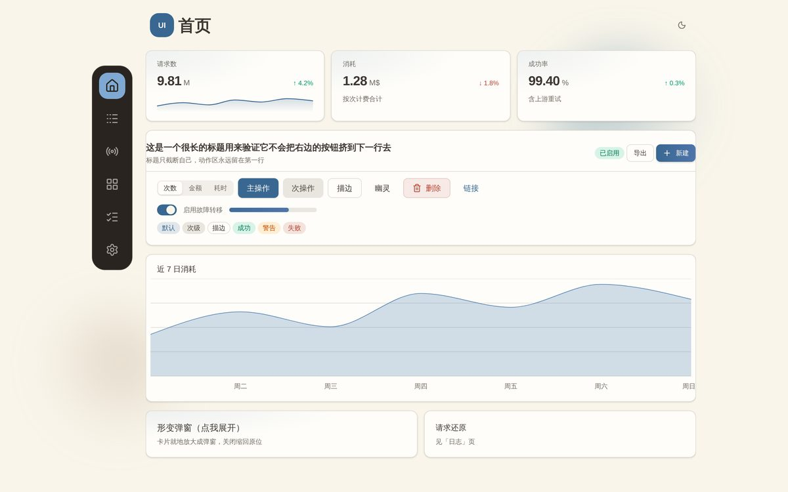
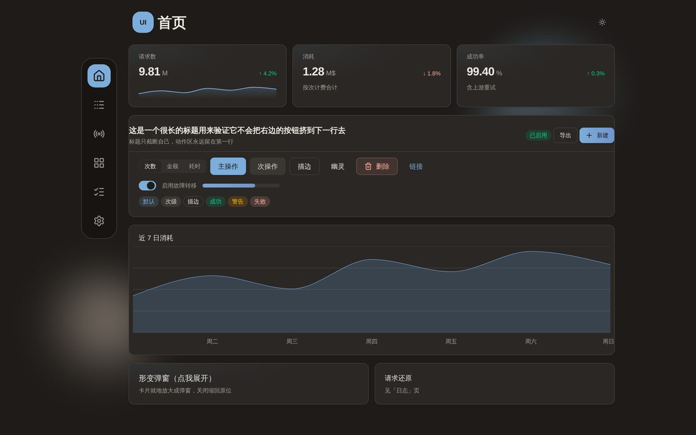
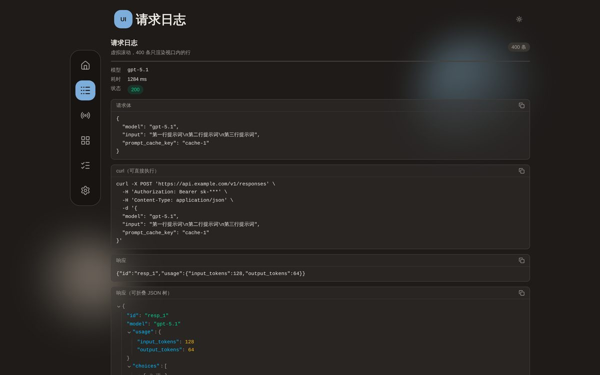
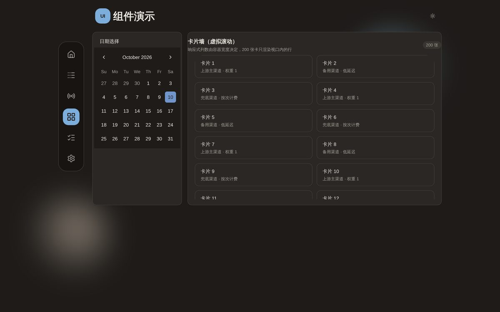
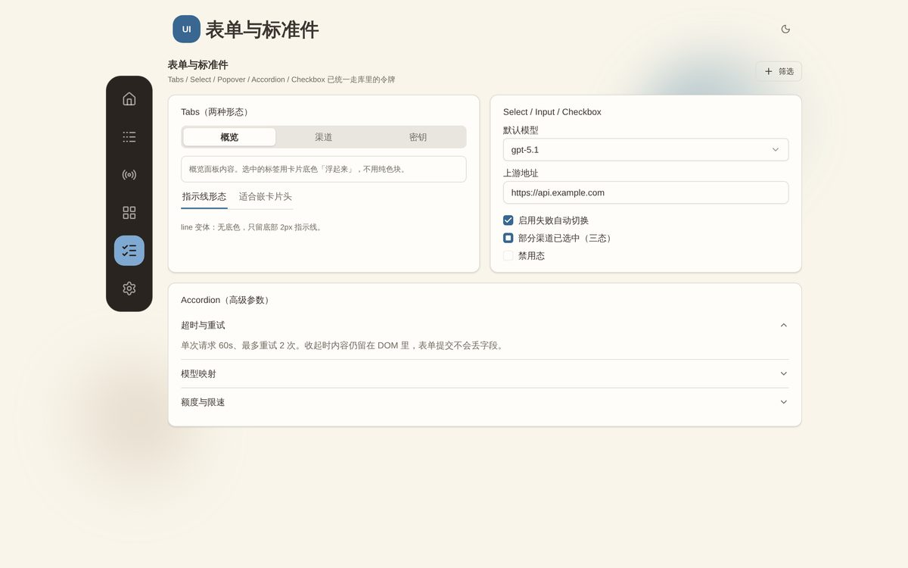
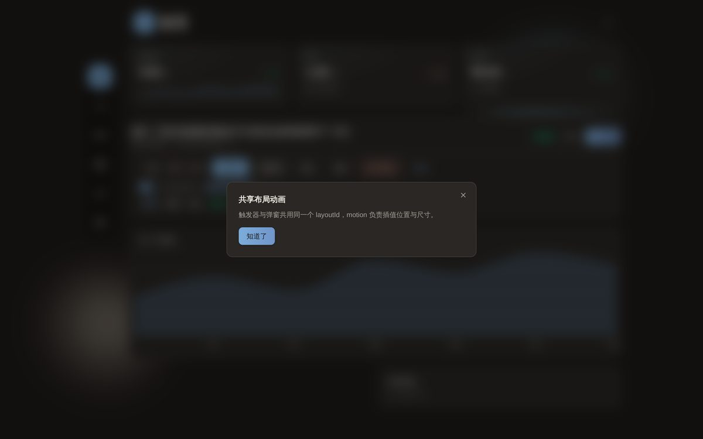
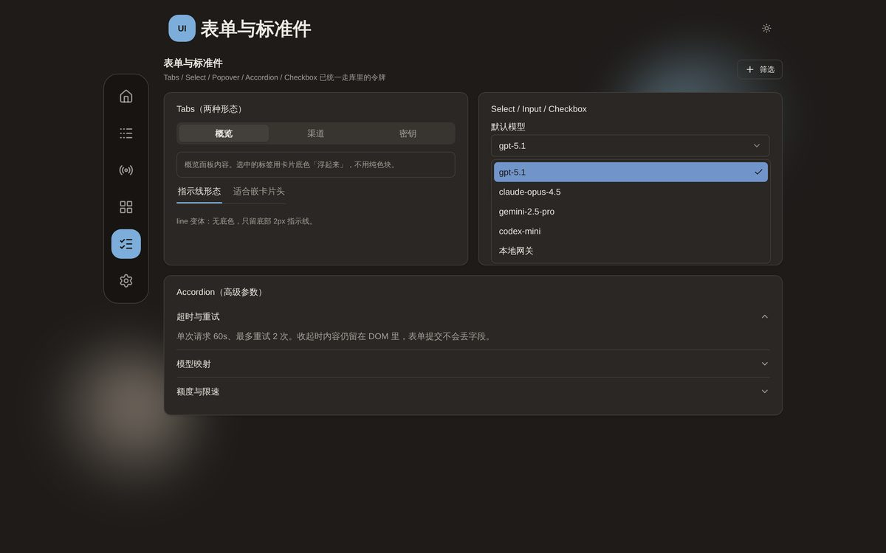
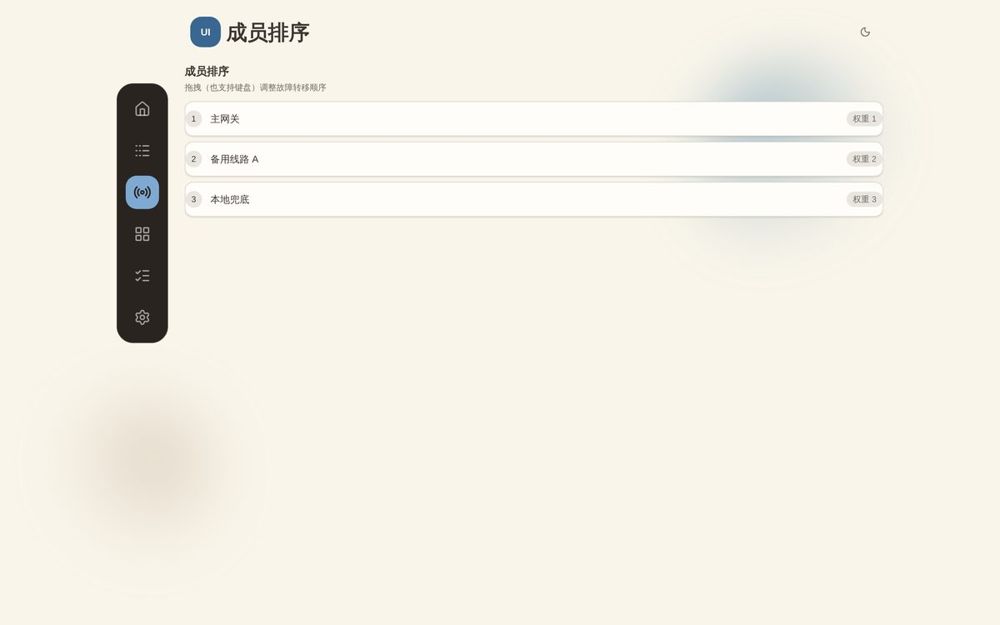

<div align="center">

# inkstone-ui

**一套「暖纸 + 钢蓝」的 React 组件库**

设计令牌 · 通用组件 · 交互模式 —— 从控制台类应用（日志 / 指标 / 表格密集）的实战里提炼出来的。

[](LICENSE)
[](https://react.dev)
[](https://tailwindcss.com)
[](https://www.typescriptlang.org)
[](#设计语言)

[设计规范](docs/07-设计规范.md) · [组件清单](docs/02-组件清单.md) · [设计方案](docs/06-设计方案.md) · [复用指南](docs/04-复用指南.md) · [起步指南](docs/08-新项目起步指南.md)

</div>

---

## 预览

| 浅色（暖象牙纸面） | 深色（暖炭） |
| :---: | :---: |
|  |  |

<details>
<summary>更多截图：日志还原 / 组件墙 / 表单 / 拖拽排序 / 形变弹窗 / 下拉</summary>

| | |
| :---: | :---: |
|  |  |
|  |  |
|  |  |

</details>

## 这是什么

一套可以直接装进后台/控制台类项目的 UI 组件库，包含三部分：

- **设计令牌**（`tokens.css`）：40+ 个 oklch 语义变量 + 明暗两套，换品牌色只改 3 个变量；
- **通用组件**：从原子件（Button / Tabs / Select / Calendar…）到通用件（StatCard / Sparkline / VirtualizedList / SortableList / JsonViewer）；
- **交互模式**：请求还原（可复制 curl）、形变弹窗（卡片就地放大）、悬浮 Dock 导航、虚拟滚动、拖拽排序。

不是"另一套 shadcn 皮肤"——它的重点在于**把控制台里最烦人的几个界面问题做成了现成件**（见下方特性）。

## 设计语言

> **暖纸 + 一处钢蓝。** 中性色全部取暖（色相 55°~95°），品牌蓝独占冷带（248°~258°）——界面因此有焦点，又不花。

三条硬规则（完整版见[设计规范](docs/07-设计规范.md)）：

1. **色温铁律**：不给中性色加冷色相。否则卡片里的进度轨、分隔线、输入框描边会和暖卡底「冷暖咬合」发脏。
2. **对比度口径**：正文 ≥ 7:1、次要文字 ≥ 4.5:1、描边/轨迹 ≥ 1.15:1；改色后**实测**，别靠肉眼。
3. **深色是单独调的一套，不是简单反色**：暗底上主色更亮、危险色取浅珊瑚红（深红在暗底上只有 2.4:1）。

为什么这么选、踩过哪些坑，都记在 [`docs/06-设计方案.md`](docs/06-设计方案.md) 里。

## 特性

| | 说明 |
|---|---|
| 🎨 **一套令牌吃两种主题** | 浅深各一套 oklch 值写在 `tokens.css`，切主题只改 `<html>` 的 class |
| 📋 **请求还原** | 字段区 + 多行请求体 + **可执行 curl**（一键复制粘贴到终端就能跑），排障不用再翻折叠 JSON |
| 🪟 **形变弹窗** | 卡片就地放大成弹窗，保留列表 → 详情的空间连续性 |
| 🧭 **悬浮 Dock 导航** | 手机底部横排、桌面左侧竖排，同一份 DOM；两个滑块位置靠 CSS 变量算 |
| ⚡ **虚拟滚动** | 列表 / 网格两版：WebKit 实测 1 万行无卡顿；三个必踩的坑都写进了源码注释 |
| 🌲 **JSON 树** | 自研可折叠 JSON 查看器，零第三方依赖，带"套娃"防御（最多剥两层，剥不动退回 `<pre>`） |
| 📊 **图表走令牌** | recharts 封装，内部元素的中性色由 CSS 变量接管，不逐个配颜色也随主题 |
| ♻️ **源码形式发布** | 消费者改一处令牌全局生效，不用等库发版；调试直接跳源码 |

## 快速开始

> 完整版（每一条命令都实测跑过）见 [`docs/08-新项目起步指南.md`](docs/08-新项目起步指南.md)。

```bash
# 1. 装（也可直接指向本仓库）
npm install /path/to/inkstone-ui-0.1.0.tgz
npm install -D tailwindcss @tailwindcss/vite tw-animate-css
```

```ts
// 2. vite.config.ts —— 让 Vite 不要预打包本库（源码直发）
export default defineConfig({
  plugins: [react(), tailwindcss()],
  optimizeDeps: { exclude: ['inkstone-ui'] },
})
```

```css
/* 3. src/index.css —— 引令牌 + 让 Tailwind 扫到库源码 */
@import "tailwindcss";
@import "tw-animate-css";
@import "inkstone-ui/styles/tokens.css";
@import "inkstone-ui/styles/base.css";
@source "../node_modules/inkstone-ui/src";
```

```tsx
// 4. src/main.tsx —— 根节点包一层 Provider
import { UIKitProvider } from 'inkstone-ui'

createRoot(document.getElementById('root')!).render(
  <UIKitProvider>
    <App />
  </UIKitProvider>,
)
```

```tsx
// 5. 用起来
import { AppShell, DockNav, PageHeader, StatCard, Card } from 'inkstone-ui'

export function App() {
  return (
    <AppShell
      nav={<DockNav items={[
        { key: 'home', label: '首页', icon: Home },
        { key: 'logs', label: '日志', icon: List },
      ]} value="home" onChange={() => {}} />}
    >
      <PageHeader title="首页" description="概览" />
      <Card>
        <StatCard label="请求数" value={9812345} format="count" delta={4.2} />
      </Card>
    </AppShell>
  )
}
```

> ⚠️ 第 3 步少一条 `@source` 会**能构建、不报错、但页面全裸样式**——这是最常见的接线事故。

## 目录结构

```
src/
├── styles/
│   ├── tokens.css        # 设计令牌（浅色 :root / 深色 html.dark）
│   ├── base.css          # 基线样式 + recharts 内部元素取色
│   └── globals.css       # 汇总入口（消费者可只用 tokens + base）
├── components/
│   ├── ui/               # 原子件（Button / Tabs / Select / Calendar / Chart…）
│   ├── shell/            # 外壳（AppShell / DockNav / PageHeader）
│   ├── data/             # 数据展示（StatCard / Sparkline / VirtualizedList / RequestDetail…）
│   ├── AnimatedNumber.tsx
│   ├── CopyButton.tsx
│   └── IconButton.tsx
├── providers/            # UIKitProvider / ThemeProvider
├── hooks/                # useClickOutside / useEventSource
├── stores/               # usePageActions（页面动作上浮）
├── lib/                  # cn / 格式化 / curl 拼装
└── index.ts              # 公共出口
preview/                  # 本地预览页（本仓库开发用，不随包发布）
docs/                     # 设计规范与指南
```

## 常用命令

| 命令 | 作用 |
|---|---|
| `npm run dev` | 起本地预览（`127.0.0.1:5173`） |
| `npm run typecheck` | `tsc --noEmit`，零错误的门槛 |
| `npm run build` | 类型检查 + 生产构建（验证可编译） |
| `npm run pack:check` | `npm pack --dry-run`，看要打进包里哪些文件 |
| `make lint` / `make check` | 便捷别名（见 `Makefile`） |

## 文档

| # | 文档 | 内容 |
|---|---|---|
| 02 | [组件清单](docs/02-组件清单.md) | 全部组件的 Props / 状态矩阵 |
| 03 | [设计语言](docs/03-设计语言.md) | 令牌速查 + 通用规则 |
| 04 | [复用指南](docs/04-复用指南.md) | 四种集成方式（从整库到挑件） |
| 05 | [许可与合规](docs/05-许可与合规.md) | MIT 许可 + 第三方依赖许可 + 设计参考来源说明 |
| 06 | [设计方案](docs/06-设计方案.md) | 选型理由、ADR、踩过的坑 |
| 07 | [设计规范](docs/07-设计规范.md) | **完整规范**：色彩 / 布局 / 组件 / 模式 / 换肤 / 自查清单 |
| 08 | [起步指南](docs/08-新项目起步指南.md) | 从零把库接进新项目（实测命令） |

## 环境要求

| 项 | 要求 |
|---|---|
| Node | ≥ 20 |
| React | 19（peer：`>=19.0.0`） |
| Tailwind CSS | v4（主题在 CSS 里，没有 `tailwind.config.js`） |
| 浏览器 | 支持 oklch 与 `@layer` 的现代浏览器（Chrome/Edge 111+、Safari 16.4+、Firefox 113+） |

## 许可

[MIT](LICENSE) © xiaoqi0102 —— 可商用、可闭源、可修改、可再分发，保留版权声明即可。

本库的设计语言与部分交互规则，是研究开源项目 [`bestruirui/octopus`](https://github.com/bestruirui/octopus)（AGPL-3.0）的前端之后**重新实现**的：
组件代码独立编写，令牌色值与视觉形态已整套替换，不复制其源码、色值与业务模块。详见 [许可与合规](docs/05-许可与合规.md)。

第三方依赖许可见 [THIRD-PARTY-NOTICES.md](THIRD-PARTY-NOTICES.md)（MIT 19 · Apache-2.0 3 · ISC 1，无传染性许可）。
